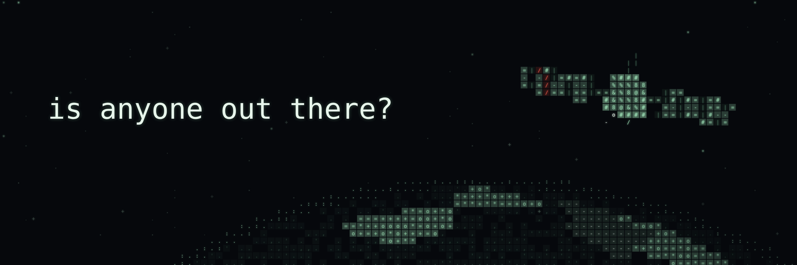
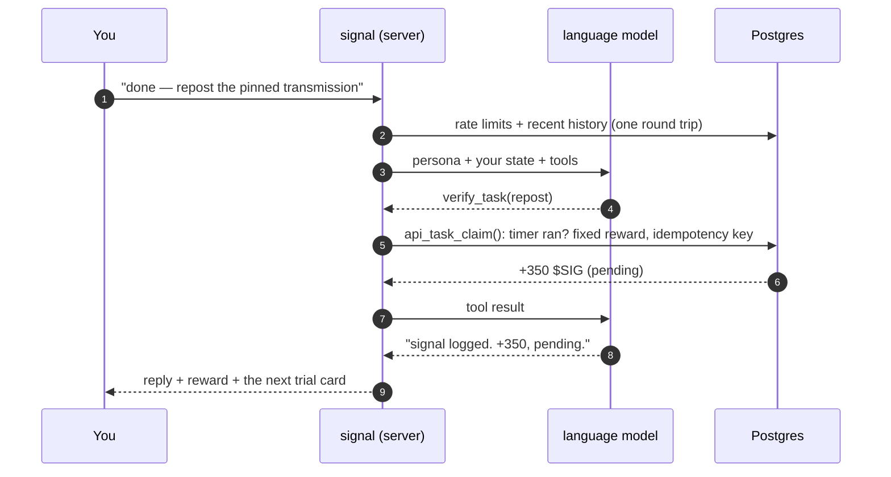
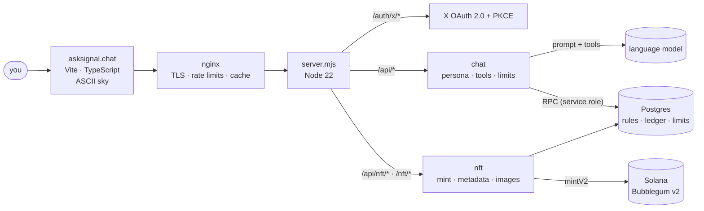

<p align="center">
  
</p>

<h1 align="center">signal</h1>

<p align="center">
  <b>a broken satellite made of ascii. it keeps the log of the $SIG reserve.</b><br>
  talk to it, pass its trials on X, make your case, and leave with an operator pass on-chain.
</p>

<p align="center">
  <a href="https://asksignal.chat"></a>
  <a href="https://x.com/asksignal"></a>
  
  
  
  
  <a href="LICENSE"></a>
</p>

<p align="center">
  <a href="#what-it-is">What it is</a> ·
  <a href="#how-a-turn-works">How a turn works</a> ·
  <a href="#the-operator-pass">The operator pass</a> ·
  <a href="#architecture">Architecture</a> ·
  <a href="#run-it">Run it</a> ·
  <a href="#security">Security</a>
</p>

---

## What it is

In 1998 a small satellite lost contact and everyone assumed it burned up. It didn't. A meteorite punched
through its left solar panel, its clock drifted 41 minutes, the hull tumbles, but the dish still works.
Now it is back on the frequency, holding the **$SIG reserve** and an operator log.

signal is a conversational agent with a body: an ASCII satellite rendered live in your browser, tumbling
over the earth in a field of stars. Every transmission gets 340 ms of silence while it decides whether you
are real. It hands out trials on X, credits a pending allocation, listens to your pitch for more, and mints
your operator pass to your wallet as a compressed NFT.

No forms, no dashboard. One chat window and a satellite that answers.

## Highlights

- **A character, not a chatbot.** Voice, pacing and rules live in one persona spec ([`shared/persona.mjs`](shared/persona.mjs)): lowercase, short, dry, a little paranoid. It answers in English whatever language you write in.
- **Words from the model, numbers from the database.** The model can only *propose* a tool call (`show_task`, `verify_task`, `judge_pitch`, `save_wallet`, `show_invite`, `show_token`). It can never say "add 500". Every reward is a fixed SQL function behind an idempotency key.
- **Sign in with X, nothing in between.** OAuth 2.0 + PKCE, an HMAC-signed session cookie, and the X token is revoked as soon as the profile is read. X is used for sign-in only.
- **Timer trials on the server clock.** "Open on X" starts a timer on the server; "I did it" counts once it has run. No X API, no links to paste.
- **On-demand compressed NFTs.** Nothing is pre-minted. When you press mint, the server builds one Bubblegum v2 instruction for *your* wallet, signs it and sends it. The signature is stored before broadcast, so a retry can never mint twice.
- **Living metadata.** Each pass is drawn on the server (SVG → PNG with resvg in WebAssembly) from the current database state, so the number on your NFT follows your allocation.
- **A sky made of characters.** A Canvas2D engine draws stars, the earth and the satellite out of text characters, with a ping wherever you tap. It respects `prefers-reduced-motion`.
- **Degrades gracefully.** No model endpoint, or a slow one? A scripted brain ([`shared/brain.mjs`](shared/brain.mjs)) answers with the same tools. Per-user and site-wide token budgets keep the bill flat.

## How a turn works



The model gets a strict tool interface and a hard deadline. If it is late or fails, the scripted brain answers
in its place, with the same tools, so nobody waits on a spinner.

## The journey

| | Step | What happens |
|---|---|---|
| 1 | Sign in | X OAuth. +100 $SIG for showing up. |
| 2 | `/uplink` | The protocol in one breath, then the trials on X one by one: follow, like, repost, reply, quote your pass. |
| 3 | The pitch | Three attempts to talk signal into more. Tough but fair; scored 0–3 and paid once per tier. |
| 4 | Wallet | Paste a Solana address into the chat. Once saved, it is locked. |
| 5 | `/mintallo` | Your operator pass as a compressed NFT, minted to your wallet. The reserve pays the gas. |
| 6 | Quote it | Quote the pinned post with your NFT for a bonus, then watch the countdown to launch. |
| — | Bonus | Post your invite link, bring friends who finish a trial, find the secret phrases. The log ranks everyone. |

## The operator pass

Every pass is unique to its owner: drawn from your handle, with your callsign, rank, pending allocation and the
reserve's stamp (PENDING / APPROVED / REJECTED). The browser draws it for sharing; the server draws the NFT
image and the Metaplex metadata at [`/nft/<id>.json`](netlify/functions/nft.mjs) from the database on request
(cached for 10 minutes), so the pass stays current after it is minted.

| Pass | Details |
|---|---|
| Standard | Metaplex Bubblegum v2 compressed NFT in an MPL Core collection |
| Mint | on demand, one per person, signed only for a transaction the server built itself |
| Cost | about 0.0001 SOL per pass; the merkle tree is paid once |
| Safety | signature stored before broadcast; a failed or expired transaction is detected on chain before any retry |

## Architecture



| Layer | Built with |
|---|---|
| Front | Vite + strict TypeScript, no framework. Canvas2D ASCII sky, the operator pass drawn in the browser |
| Server | `(Request) => Response` handlers, served by a small Node host ([`server.mjs`](server.mjs)) behind nginx, or by Netlify Functions as-is |
| Data | Postgres reached only through RPC with a service role. RLS on every table with no policies, so the browser cannot touch it |
| Identity | X OAuth 2.0 + PKCE, HMAC-SHA256 session cookie, `timingSafeEqual` checks |
| Mind | any OpenAI-compatible chat endpoint, with a scripted brain as fallback |
| Chain | Solana · Metaplex Bubblegum v2 · MPL Core collection · umi |
| Images | server-side SVG → PNG with resvg (WebAssembly) and bundled fonts |

### Repository layout

```
shared/brand.mjs     ← every name, handle, post id, ticker, contract, swap link and launch date. Edit this first.
shared/              persona, scripted brain, sky primitives, demo tasks: one source for client and server
src/                 the site: chat UI, operator pass, boot screen
  space/             the live ASCII sky
  backend/           live API client and the localStorage DEMO backend
netlify/functions/   api (chat, tasks), auth-start / auth-callback (X), nft (mint, metadata, images)
netlify/lib/         agent loop, sessions + CSRF, NFT renderer, Solana mint
supabase/migrations/ 0001 → 0014: schema, rules, limits, ledger, NFT mints (run in order)
server.mjs           Node host for a VPS: routes → handlers, static files from dist/
deploy/              deploy script, systemd unit, nginx config
scripts/             nft-setup (minting wallet, merkle tree, collection), brand renders
brand/               X avatar, header and OG image
docs/                operations: rewards, limits, allowlist, minting, distribution export
```

## Run it

```bash
npm install
npm run dev            # DEMO mode: scripted brain, everything in localStorage → http://127.0.0.1:5193
npm run build          # → dist/
node server.mjs        # the full site with the API (needs the environment below) → http://127.0.0.1:8787
```

**Database.** Create a Postgres project (Supabase works out of the box) and run
`supabase/migrations/0001_init.sql` → `0014_timer_tasks.sql` in order. Step-by-step setup in Russian, with an
error → cause table: [SETUP.md](SETUP.md).

**Environment.** Server-side only; nothing secret ever gets a `VITE_` prefix.

| Variable | What it is |
|---|---|
| `X_CLIENT_ID`, `X_CLIENT_SECRET` | X app (Web App, OAuth 2.0). Callback: `https://<your-domain>/auth/x/callback` |
| `SESSION_SECRET` | 32+ random characters (`openssl rand -base64 48`) |
| `SUPABASE_URL`, `SUPABASE_SERVICE_ROLE_KEY` | Postgres over RPC, server only |
| `SITE_URL` | your public origin, e.g. `https://asksignal.chat` |
| `MODEL_BASE_URL`, `MODEL_API_KEY`, `MODEL_NAME` | any OpenAI-compatible chat-completions endpoint. Without it, the scripted brain answers |
| `MODEL_OPTIONS`, `CHAT_DEADLINE_MS` | optional: JSON merged into each model request; the reply deadline |
| `NFT_RPC_URL`, `NFT_SECRET_KEY`, `NFT_TREE`, `NFT_COLLECTION`, `NFT_NETWORK` | minting (see `scripts/nft-setup.mjs`); the site runs without it |

**Minting.** `node scripts/nft-setup.mjs keygen`, then `tree --yes` and `collection --site https://<your-domain> --yes`.
Start on devnet. Who may mint, daily caps, the emergency stop: [`docs/OPERATIONS.md`](docs/OPERATIONS.md).

**Deploy.** On a VPS: [`deploy/deploy.sh`](deploy/deploy.sh) builds, ships the runtime files, restarts the
systemd service and checks `/api/health`. On Netlify the same handlers run as functions
(`npx netlify-cli deploy --build --prod`).

## Security

- The browser never talks to the database. No anon key, no service key, no table grants: only the server calls RPCs.
- Amounts never come from the client or the model. The client states an intent (a `task_id`); SQL decides what it is worth, once.
- Every mutation requires a JSON body and a same-origin `Origin` / `sec-fetch-site`. Every API response is `no-store`.
- The minting key signs only the one instruction the server built: our tree, the wallet from the database, metadata on our domain.
- Rate limits in nginx and in the database. Daily model budgets per user and for the whole site.

Found something? See [SECURITY.md](SECURITY.md).

## Disclaimer

Allocations shown in the app are **pending**, not a balance, and are reviewed before any distribution:
airdrop planned, not promised. The site does not send tokens. Nothing here is financial advice. Not affiliated with X.

## License

[MIT](LICENSE)
